<div align="center">

<!-- Live Contribution Heatmap Terminal -->


<br><br>

<!-- Terminal Hero: Self-typing Monochrome ASCII Portrait + Neofetch Info Card -->
<table>
  <tr>
    <td valign="top">
      
    </td>
    <td valign="top">
      
    </td>
  </tr>
</table>

<br>

<!-- Quick Bio Banner -->
<p align="center">
  <b>Computer Engineering Student (UDG) & Full Stack Software Engineer</b><br>
  Specializing in <b>Clean Architecture</b>, <b>Microservices</b>, and <b>AI Integration</b>.<br>
  Passionate about architecting reliable cloud applications, multi-objective optimization algorithms, and modern web platforms.
</p>

<p align="center">
  <a href="https://www.linkedin.com/in/eduardo-domínguez-padilla"></a>
  &nbsp;
  <a href="mailto:laloteco123@gmail.com"></a>
  &nbsp;
  <a href="https://github.com/eduardotec05"></a>
</p>

</div>

<br>

---

### 💻 Technical Stack & Skills

```json
{
  "languages": ["TypeScript", "JavaScript", "Python", "Java", "C++", "SQL"],
  "frontend": ["Angular 20 (Signals, Standalone)", "React", "Tailwind CSS", "HTML5", "CSS3"],
  "backend": ["NestJS 11", "Node.js", "Spring Boot", "Django", "Flask", "RESTful APIs"],
  "databases_and_orm": ["PostgreSQL", "MongoDB", "TypeORM", "SQLAlchemy"],
  "cloud_and_devops": ["AWS (S3, Lambda, Secrets)", "Google Cloud Platform", "Oracle Cloud", "Docker", "Git/GitHub", "CI/CD"],
  "architecture_and_security": ["Clean Architecture", "Microservices", "JWT", "Keycloak", "OAuth2", "OpenPay", "Unit Testing"],
  "ai_and_data_science": ["Google Gemini SDK", "Genetic Algorithms (NSGA-II)", "PyMoo", "NLP / Scikit-Learn"]
}
```

<div align="center">
  <!-- Languages -->
  
  
  
  
  
  
  <br>
  <!-- Frameworks & Tools -->
  
  
  
  
  
  
  
  <br>
  <!-- Cloud & DevOps -->
  
  
  
  
  
</div>

<br>

---

### 🚀 Featured Projects

<table>
  <tr>
    <td width="50%" valign="top">
      <h4>🏛️ CUTepa Institutional Platform</h4>
      <p><b>Role:</b> Full Stack Software Engineer</p>
      <p>Enterprise university ecosystem powering admissions, student portal, faculty administration, and financial billing.</p>
      <ul>
        <li>Implemented under <b>Clean Architecture</b> using <b>Angular 20</b> (Signals) and <b>NestJS 11</b> with <b>TypeORM</b> & PostgreSQL.</li>
        <li>Financial core automating tuition computation, discounts, and payment gateway integration with <b>OpenPay</b>.</li>
        <li>Cloud document management with <b>AWS S3</b> pre-signed URLs, session security with <b>Keycloak + JWT</b>, and institutional AI assistant with <b>Google Gemini Flash SDK</b>.</li>
      </ul>
      <p>
        <code>Angular 20</code> &nbsp; <code>NestJS</code> &nbsp; <code>PostgreSQL</code> &nbsp; <code>AWS S3</code> &nbsp; <code>Keycloak</code> &nbsp; <code>OpenPay</code>
      </p>
    </td>
    <td width="50%" valign="top">
      <h4>🧬 AI Multi-Objective Team Formation (NSGA-II)</h4>
      <p><b>Role:</b> Full Stack & AI Developer (CUAltos - UDG)</p>
      <p>Production AI platform built to automate optimal multidisciplinary collaborative student team generation.</p>
      <ul>
        <li>Evolutionary optimization engine powered by <b>NSGA-II (PyMoo)</b> optimizing psychometric profiles, soft skills, and <b>Felder-Silverman</b> learning styles.</li>
        <li>Interactive dashboard built with <b>React</b>, <b>Tailwind CSS</b>, and <b>Flask</b> with automatic group feasibility diagnosis.</li>
        <li>Real-time <b>Pareto frontier</b> visualization helping educators make data-driven classroom decisions.</li>
      </ul>
      <p>
        <code>Python</code> &nbsp; <code>PyMoo / NSGA-II</code> &nbsp; <code>Flask</code> &nbsp; <code>React</code> &nbsp; <code>Tailwind</code> &nbsp; <code>PostgreSQL</code>
      </p>
    </td>
  </tr>
  <tr>
    <td width="50%" valign="top">
      <h4>🏆 SentimentAPI Microservice (Oracle ONE Hackathon - Top 20)</h4>
      <p><b>Role:</b> Backend & ML Engineer</p>
      <p>Microservice engineered for ultra-fast sentiment classification on public feedback and user commentary.</p>
      <ul>
        <li>Engineered, trained, and fine-tuned machine learning models for high accuracy natural language prediction.</li>
        <li>Constructed a decoupled REST microservice architecture optimized for concurrent, low-latency API inference.</li>
        <li>Selected in the <b>Top 20</b> out of hundreds of projects in the competitive Oracle Next Education Hackathon.</li>
      </ul>
      <p>
        <code>Python</code> &nbsp; <code>Scikit-Learn</code> &nbsp; <code>NLP</code> &nbsp; <code>REST API</code> &nbsp; <code>Docker</code>
      </p>
    </td>
    <td width="50%" valign="top">
      <h4>📚 Academic Congress Management Platform</h4>
      <p><b>Role:</b> Full Stack Engineer</p>
      <p>Collaborative web application for organizing, scheduling, and moderating university academic congresses.</p>
      <ul>
        <li>Full-stack development with <b>Django</b>, <b>React</b>, and <b>PostgreSQL</b>.</li>
        <li>Role-based access control (administrators, speakers, attendees, evaluators) with automated certification generation.</li>
        <li>Comprehensive Git workflow, unit testing, and team-based code review ensuring architectural integrity.</li>
      </ul>
      <p>
        <code>Django</code> &nbsp; <code>React</code> &nbsp; <code>PostgreSQL</code> &nbsp; <code>Clean Code</code>
      </p>
    </td>
  </tr>
</table>

<br>

---

### 💼 Professional Experience

```
[Jul 2026 - Present]  Full Stack Developer @ CUTepatitlán
                      • Architecting enterprise university system in Angular 20 & NestJS 11
                      • Secure cloud storage with AWS S3 & authentication with Keycloak/JWT
                      • Automated OpenPay billing pipeline & integrated Google Gemini AI assistant

[Mar 2026 - Sep 2026] Full Stack & AI Developer @ CUAltos (Universidad de Guadalajara)
                      • Developed & deployed NSGA-II genetic algorithm optimization platform
                      • Automated student team assembly using psychometric models & Pareto frontiers
                      • Stack: Flask, React, Tailwind CSS, PostgreSQL, PyMoo
```

<br>

---

### 🎓 Education & Certifications

* **B.S. in Computer Engineering** — *Universidad de Guadalajara (CUAltos)* `[7th Semester - In Progress]`
* **Data Science Specialization (G8)** — *Oracle Next Education & Alura Latam* `[2025]`
* **Google Cybersecurity Professional Certificate** — *Coursera* `[2024]`
* **Google Cloud Computing Foundations Certificate** — *Google Cloud* `[2024]`
* **ISO 9001 Auditor** — *Los Ninger* `[In Progress]`

<br>

---

<div align="center">

### 🕹️ Contribution Activity

<!-- Automated Contribution Snake Game -->
<picture>
  <source media="(prefers-color-scheme: dark)" srcset="https://raw.githubusercontent.com/eduardotec05/eduardotec05/output/snake.svg" />
  <source media="(prefers-color-scheme: light)" srcset="https://raw.githubusercontent.com/eduardotec05/eduardotec05/output/snake.svg" />
  
</picture>

<br><br>

<p>
  <b>Eduardo Domínguez Padilla</b> &nbsp;·&nbsp;
  <a href="https://www.linkedin.com/in/eduardo-domínguez-padilla">LinkedIn</a> &nbsp;·&nbsp;
  <a href="mailto:laloteco123@gmail.com">laloteco123@gmail.com</a> &nbsp;·&nbsp;
  <a href="https://github.com/eduardotec05">GitHub Profile</a>
</p>

</div>
